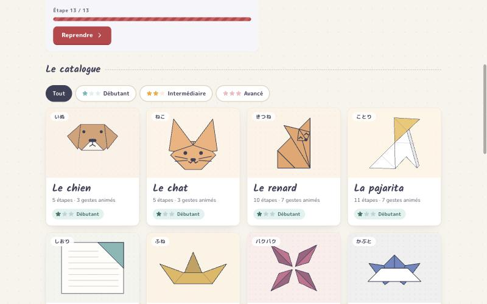
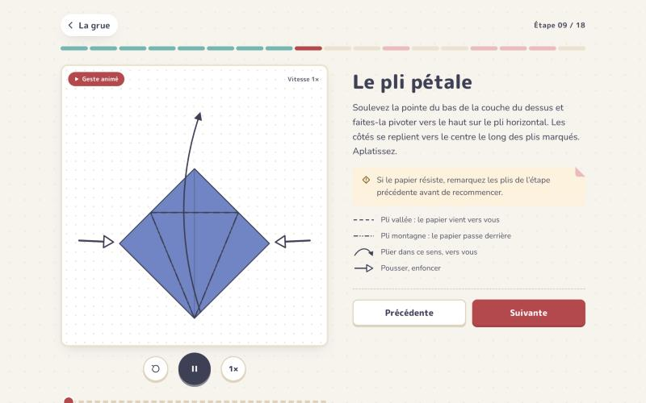

<p align="center">
  
</p>

<h1 align="center">Pli — origami en famille</h1>

<p align="center">
  Des origamis pas à pas, pour les petits comme pour les grands.<br />
  Les gestes délicats sont <strong>animés</strong>, les autres restent des schémas clairs.
</p>

<p align="center">
  
</p>

Une SPA qui guide le pliage d'origamis étape par étape. Les étapes simples restent des schémas fixes ; les gestes délicats (base carrée, pli pétale, plis inversés, ouvertures en losange…) sont animés, en boucle, avec lecture/pause, vitesse ½×, rejouer et défilement image par image. La progression de chaque modèle est gardée dans le navigateur.

<p align="center">
  
</p>

Vingt modèles, rangés par niveau :

| Niveau | Modèle | Étapes | Gestes animés |
| --- | --- | --- | --- |
| Débutant | **le chien** (inu) | 5 | 3 |
| Débutant | **le chat** (neko) | 5 | 3 |
| Débutant | **le renard** (kitsune, d’après Mitsuo Okuda) | 10 | 7 |
| Débutant | **la pajarita** (l’oiseau de papier d’Espagne) | 11 | 7 |
| Débutant | **le marque-page** d’angle (Nick Robinson) | 11 | 6 |
| Débutant | **le bateau** | 8 | 3 |
| Débutant | **la cocotte** | 7 | 1 |
| Intermédiaire | **le kabuto** (casque de samouraï) | 8 | 3 |
| Intermédiaire | **le ballon** (kami fūsen) | 9 | 4 |
| Intermédiaire | **la grenouille sauteuse** (pyon-pyon gaeru) | 9 | 7 |
| Intermédiaire | **le lapin** (usagi) | 13 | 11 |
| Intermédiaire | **l’écureuil** (risu, de Sébastien Limet) | 15 | 12 |
| Intermédiaire | **le papillon** (chō) | 13 | 8 |
| Intermédiaire | **la grue** (tsuru) | 18 | 6 |
| Intermédiaire | **la grue qui bat des ailes** (habataku tori) | 17 | 8 |
| Avancé | **la boîte masu** | 8 | 4 |
| Avancé | **le cube modulaire** (6 modules Sonobe) | 9 | 5 |
| Avancé | **le lys** (yuri) | 12 | 4 |
| Avancé | **la grenouille traditionnelle** (kaeru) | 15 | 9 |
| Avancé | **l’étoile kusudama** (30 modules Sonobe) | 10 | 5 |

## Démarrer

```bash
npm install
npm run dev      # http://localhost:5173
npm run build    # vérifie les types puis construit dans dist/
npm run preview  # sert la version construite
```

Il faut Node 20.19 ou plus récent (exigence de Vite 8).

Vite 8, React 19, TypeScript. Aucune autre dépendance : routage par hash, progression dans `localStorage`.

## Déployer

Le site est entièrement statique. `vite.config.ts` utilise `base: './'` et le routage passe par le hash (`#/m/grue/9`) : le dossier `dist/` fonctionne tel quel à la racine d'un domaine comme dans un sous-dossier, sans réécriture d'URL côté serveur (Netlify, un hébergement mutualisé, GitHub Pages…).

Pour GitHub Pages, le plus simple : *Settings → Pages → Source : GitHub Actions*, avec un workflow qui lance `npm ci && npm run build` puis publie `dist/` (actions `actions/upload-pages-artifact` et `actions/deploy-pages`). Le site sera servi sur `https://coroller1972.github.io/pli/`.

## Organisation

```
src/
  pliage/            le moteur
    types.ts         Plan, Figure, Ligne, Fleche, Geste, Piste
    geo.ts           géométrie : reflet (un pli à plat), rotation, intersections, aire signée
    moteur.ts        calcule les plans à dessiner à l'instant t d'un geste
    Schema.tsx       rendu SVG : papier, notation (lignes, flèches)
    Lecteur.tsx      le lecteur d'un geste animé + la planche fixe
  modeles/           un fichier par modèle, toute la géométrie y est calculée
    chien.ts  chat.ts  marque-page.ts  bateau.ts  cocotte.ts  kabuto.ts  ballon.ts
    grenouille.ts  lapin.ts  papillon.ts  grenouille-traditionnelle.ts  grue-ailes.ts
    renard.ts  ecureuil.ts  pajarita.ts
    grue.ts  masu.ts  cube.ts  lys.ts  etoile.ts  index.ts
    sonobe.ts        le module Sonobe, commun au cube et à l'étoile
    espace.ts        un peu de 3D : rotation, projection, lumière
    outils.ts        cadreDe() : le cadre qui contient des plans
  ecrans/            Catalogue, Presentation, EtapeEcran, Fin
  ui/                icônes, décors (nuages, sakura, vagues), légende de notation, illustration
  hooks/             route (hash), progression, mouvement réduit
  styles/            tokens.css (la DA), global.css
```

## Comment marche une animation

Une figure est une liste de **plans** : des polygones de papier, chacun avec la face visible (`recto` ou `verso`). Un **geste** est une suite de **pistes** jouées sur ces plans, chacune sur une fenêtre de temps :

- `pli` : fait tourner des plans autour d'un axe en 3D (avec une légère perspective). C'est le pli vallée ou montagne d'un rabat.
- `rotation` : fait pivoter des plans dans le plan du dessin (le cou de la grue qui remonte).
- `morph` : déforme des plans vers une forme cible, sommet par sommet (le pli pétale, la base carrée).

Deux règles rendent le tout crédible sans rien déclarer à la main :

1. **La face se déduit de l'orientation.** Quand un polygone se retourne, son aire signée change de signe : le moteur montre alors l'autre face du papier.
2. **L'ombre se déduit de l'aire apparente.** Un rabat à 90° est vu par la tranche, son aire chute : il s'assombrit. Une simple rotation garde son aire et reste clair.

Trois réglages par plan, pour les cas particuliers :

- `dos` : la face montrée une fois retourné. Un rabat de deux couches, coloré des deux côtés, reste coloré (`rabat()` dans `geo.ts`).
- `zRetourne` : le rang de dessin une fois retourné. La pointe du kabuto ou du ballon passe ainsi *sous* la couche dans laquelle elle se glisse.
- `teinte` : une couleur imposée, pour les pliages modulaires en plusieurs feuilles de couleur.
- Les lignes `feutre` : un trait dessiné sur le modèle (la frimousse du chien et du chat), avec une `epaisseur`.

La boîte masu passe en **vue de biais** pour la mise en volume : chaque morceau de papier y est placé en 3D, état par état, puis projeté en isométrique (`iso()` dans `masu.ts`). Le moteur ne fait qu'interpoler entre ces projections. Le cube et l'étoile vont plus loin avec `espace.ts` : les faces sont placées en 3D, éclairées selon leur orientation, triées de la plus lointaine à la plus proche, et l'assemblage est montré en vue éclatée qui se referme. L'étoile est calculée à partir d'un icosaèdre : une pyramide en coin de cube sur chacune de ses vingt faces, et une recherche qui répartit les trois couleurs pour qu'aucune pyramide n'ait deux fois la même.

Les positions finales viennent de vrais calculs (`reflet` d'un point par rapport à la ligne de pli). Exemple, le pli pétale de la grue :

```ts
const Bp = reflet(B2, KG, KD); // la pointe du bas, relevée par-dessus la charnière
gestePetale = { duree: 3400, pistes: [{ type: 'morph', vers: { mt: [KG, KD, Bp], /* … */ } }] };
```

## Ajouter un modèle

1. Créer `src/modeles/mon-modele.ts` qui exporte un `Modele` : nom, niveau, papier (couleurs recto/verso), illustration finale et étapes.
2. Pour chaque étape : une `figure` (l'état du papier au début de l'étape, avec la notation du geste à faire). Ajouter un `geste` seulement si l'étape est délicate.
3. L'ajouter à `MODELES` dans `src/modeles/index.ts` (la liste est rangée par niveau).

Un modèle qui part de la base carrée peut reprendre les six premières étapes de la grue : `etapesBaseCarree` (c'est ce que font le lys et la grenouille traditionnelle). La base de la grenouille (rabats écrasés, plis pétales) se reprend du lys : `etapesBaseGrenouille` ; la base de l'oiseau, de la grue : `etapesBaseOiseau` (c'est ce que fait la grue qui bat des ailes).

Les pattes de la grenouille traditionnelle sont des plis inversés successifs : vus à plat, chacun est un reflet de la pointe le long du pli. `plierPatte()` choisit une articulation et une nouvelle direction, et en déduit le pli (la médiatrice entre la pointe et sa nouvelle place).

Pour plier une seule partie d'une couche (la tête du lapin, la queue, le museau), `couper()` dans `geo.ts` découpe un polygone le long d'un pli : chaque morceau bouge ensuite à sa façon.

Le lapin, le papillon, le marque-page, la grenouille traditionnelle, la grue qui bat des ailes, le renard, l'écureuil et la pajarita suivent les séquences présentées par origami.me ([lapin](https://origami.me/rabbit/), [papillon](https://origami.me/butterfly/), [marque-page](https://origami.me/bookmark/), [grenouille](https://origami.me/traditional-frog/), [oiseau](https://origami.me/bird/), [renard](https://origami.me/fox/), [écureuil](https://origami.me/squirrel/), [pajarita](https://origami.me/pajarita/)). Pour le lapin : la géométrie (pli écrasé sur la bissectrice, oreilles affinées jusqu'au point où elles sortent de la tête, pli en zigzag de la tête) a été recalculée et recoupée avec ses diagrammes.

Astuce : écrire la géométrie avec les fonctions de `geo.ts` plutôt qu'en coordonnées en dur. Un pli à plat, c'est `reflet(point, a, b)`.

## Direction artistique

Un « atelier pastel », pensé pour plier en famille, inspiré des tons doux d'[origami.me](https://origami.me) : du papier crème, du blanc et des couleurs poudrées.

- **Couleurs** : papier crème `#F8F3EC`, cartes blanches, encre bleu ardoise `#3D4058` plutôt que noire. Pastels : rose poudré `#F8DADA`, menthe `#5EB7B2`, sable `#ECE2CE`, ciel `#9CC6DD`, abricot `#F5A524`. Le rose framboise `#C23F49` est réservé à l'action principale et au marqueur « geste animé ». Chaque niveau a sa couleur : menthe (débutant), abricot (intermédiaire), rose (avancé). Les papiers des modèles sont eux aussi passés en pastel.
- **Typo** : Kalam, une écriture à la main, pour les grands titres et les noms des modèles ; M PLUS Rounded 1c pour l'interface, les repères et les kana ; Nunito pour les consignes.
- **Signes** : la notation des diagrammes d'origami sert aussi d'interface (séparateurs en pli vallée, coin corné sur ce qui s'ouvre). Le niveau se lit en fleurs de cerisier ; chaque modèle porte son nom en kana (つる, いぬ, ねこ, かぶと…).
- **Décors** : soleil, nuages, sakura et vagues seigaiha rose poudré, en SVG (`ui/Decor.tsx`). Une pluie de pétales fête chaque pliage terminé.
- **Matière** : coins doucement arrondis, filets sable, ombres légères, cartes teintées de la couleur du papier du modèle, boutons qui s'enfoncent quand on appuie.
- **Mouvement** : `cubic-bezier(.65, 0, .35, 1)` pour le papier, un léger rebond pour l'interface. Avec « réduire les animations » activé dans le système, rien ne démarre seul (ni les gestes, ni les nuages, ni les pétales).
- **Mode sombre** : automatique, en bleu ardoise ; la planche des schémas reste claire, comme une feuille posée sur la table.

## Accessibilité

Navigation au clavier (← → entre les étapes), focus placé sur le titre de chaque nouvelle étape, schémas décrits par un `aria-label`, cibles tactiles de 44 px minimum, contrastes AA.

## Limites connues

- Les schémas sont stylisés : ce sont des vues de face, pas une simulation 3D du papier. Pendant certains gestes, une couche intérieure apparaît brièvement.
- La dernière étape du bateau (tirer sur les côtés) et la mise en forme de la cocotte sont des animations d'intention plus que des reconstitutions exactes : à vérifier papier en main.
- Les pattes arrière de la grenouille (version fiche bristol) et la queue du lapin sont simplifiées : le dessin montre leur forme finale, pas tout le trajet des couches.
- De même pour le gonflage du ballon, l'ouverture du lys et la façon dont les bouts de la boîte masu se soulèvent pendant que l'on relève les grands côtés.
- Pour le lys et la masu, une seule face (ou un seul bout) est montrée ; les autres se plient de la même façon.
- La pajarita : chaque état à plat est relevé sur le quadrillage 4 × 4 et identique aux diagrammes ; les trois plis pivotants sont animés par un morphing vers leur position exacte, et la pose debout finale est relevée sur le diagramme du modèle terminé.
- L'écureuil : les étapes 1 à 7 (vue de face, plié en deux, profil) et la queue sont calculées pli par pli et recoupées avec les diagrammes d'origami.me. Le modelage fin de la tête (leurs étapes 12 à 20, en gros plan) est regroupé en trois gestes (le cou, la tête et les oreilles, le museau) dont les formes d'arrivée sont relevées sur les diagrammes : la position finale est fidèle, le trajet des couches entre les deux est simplifié.

## Crédits

- Le lapin, le papillon, le marque-page, la grenouille traditionnelle, la grue qui bat des ailes, le renard, l'écureuil et la pajarita suivent les séquences de pliage présentées par [origami.me](https://origami.me), qui a aussi inspiré la palette pastel. Les schémas de Pli sont redessinés et recalculés, pas copiés.
- Les auteurs des modèles : Mitsuo Okuda (le renard), Sébastien Limet (l'écureuil), Nick Robinson (le marque-page d'angle), Mitsunobu Sonobe (le module du cube et de l'étoile). Les autres modèles sont traditionnels.
- Polices : [Kalam](https://fonts.google.com/specimen/Kalam), [M PLUS Rounded 1c](https://fonts.google.com/specimen/M+PLUS+Rounded+1c) et [Nunito](https://fonts.google.com/specimen/Nunito), via Google Fonts.
